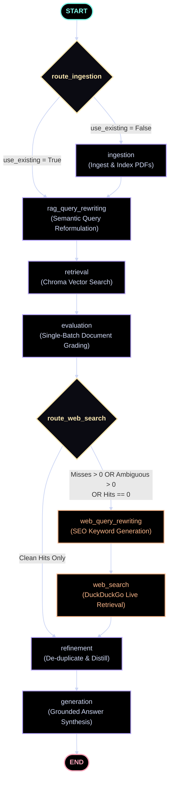

# Corrective RAG – Adaptive Retrieval Evaluation & Web Fallback Pipeline

Corrective RAG turns the blind trust of traditional vector search into a verified knowledge pipeline. Instead of a basic prompt loop that blindly trusts retrieved chunks, it uses LangGraph to grade relevance, rewrite queries, and fall back to live web search—giving you answers that are verified, current, and grounded.

---

## Table of Contents

- [What Makes It Interesting](#what-makes-it-interesting)
- [The Problem: Why Agentic Architecture Matters](#the-problem-why-agentic-architecture-matters)
- [Features](#features)
- [Tech Stack](#tech-stack)
- [Architecture Deep Dive](#architecture-deep-dive)
  - [High-Level System Architecture](#high-level-system-architecture)
  - [LangGraph Workflow and State Machine](#langgraph-workflow-and-state-machine)
  - [State Schema and Delta Propagation](#state-schema-and-delta-propagation)
  - [Core Subsystems Deep Dive](#core-subsystems-deep-dive)
  - [Node and Tool Ecosystem](#node-and-tool-ecosystem)
- [How It Works](#how-it-works)
- [Configuration Reference](#configuration-reference)
- [Programmatic Usage](#programmatic-usage)
- [Directory Structure](#directory-structure)
- [Getting Started](#getting-started)
- [Troubleshooting and FAQ](#troubleshooting-and-faq)
- [Testing](#testing)

---

## What Makes It Interesting

Built as a LangGraph agent, it goes well beyond a basic retrieve-and-generate loop:

1. **Relevance Grading**: Evaluates retrieved document chunks in a single batch against a scoring rubric (Hits, Ambiguous, Misses)—structured evaluation instead of guesswork.
2. **Dual Query Rewriting**: Expands concepts into semantic vectors for local search, and distills clean keywords for web search. The right query for each engine.
3. **Corrective Web Fallback**: Searches DuckDuckGo in real time whenever local documents are missing, outdated, or ambiguous.
4. **Context Refinement**: Combines and deduplicates local notes and web results before answering—no fluff, token waste, or repeated text.

---

## The Problem: Why Agentic Architecture Matters

Standard RAG pipelines fail in 5 major production areas:

| Failure Mode | Standard RAG Pipeline | Corrective RAG Solution |
| :--- | :--- | :--- |
| **Blind Retrieval** | Assumes all retrieved $k$-nearest neighbors are relevant; fills prompt with irrelevant passages | **Batch Grading**: Evaluates each chunk against a scoring rubric and discards misses |
| **Query Mismatch** | Sends raw conversational queries to vector search; conversational filler hurts retrieval quality | **RAG Query Rewriting**: Expands technical terms and strips conversational noise for optimal search |
| **Knowledge Gaps & Outdated Data** | Fails silently or hallucinates when the database lacks answers or is outdated | **Autonomous Web Fallback**: Searches the live web via DuckDuckGo when internal documents are missing or ambiguous |
| **Redundant Context** | Passes unrefined, repetitive text into context, wasting tokens and distracting the model | **Context Refinement**: Distills combined internal and web notes into a concise, deduplicated brief |
| **Hallucinated Answers** | Answers without grounding checks; invents facts when context is missing | **Strict Grounding**: Prompts enforce answering strictly from context or admitting missing information (*"I do not have enough information..."*) |

---

## Features

- **Agentic Workflow**: A stateful LangGraph agent that actively evaluates retrieval quality, routes decisions, and corrects knowledge gaps instead of blindly generating answers.
- **Dual-Stage Query Formulation**: Automatically formulates distinct queries for different search backends—expanding semantic vectors for local Chroma search and distilling keywords for DuckDuckGo.
- **Single-Batch Relevance Evaluator**: Evaluates all candidate chunks simultaneously in a single LLM call against a calibrated scoring rubric to filter out misses and identify ambiguous passages.
- **Resilient Web Search Fallback**: Automatically falls back to live DuckDuckGo web search when local knowledge is missing or ambiguous, with built-in network and rate-limit resilience.
- **Context Refinement & Deduplication**: Combines local document hits and external web snippets into a dense, deduplicated factual brief before synthesis.
- **Grounded Answer Synthesis**: Enforces strict context grounding during generation to prevent hallucinations, admitting missing information when context is insufficient.
- **Incremental Document Ingestion**: PyMuPDF-powered loader with recursive text splitting, content hash deduplication, and persistent Chroma vector storage.
- **End-to-End Tracing & Observability**: Integrated distributed tracing across all graph nodes and runnables via LangSmith.

---

## Tech Stack

| Component | Technology | Role |
| :--- | :--- | :--- |
| **Backend** | Python 3.14+, LangGraph | The agent orchestration engine and state machine |
| **LLM** | Google Gemini (`langchain-google-genai`) | Query rewriting, document grading, refinement, and generation |
| **Embeddings** | Google Generative AI Embeddings (`gemini-embedding-2`) | Turning text into 768-dimensional semantic vectors |
| **Vector Store** | Chroma (`langchain-chroma`) | Persistent local semantic document retrieval |
| **Document Loader** | PyMuPDF (`pymupdf`) | High-speed PDF text parsing and metadata extraction |
| **Text Splitter** | LangChain Recursive Character Splitter | Chunking text with boundary preservation and overlap |
| **Tools** | DuckDuckGo Search (`ddgs`) | Real-time web search fallback with transient error handling |
| **Observability** | LangSmith | End-to-end distributed tracing across all runnables |

---

## Architecture Deep Dive

### High-Level System Architecture

```mermaid
graph TB
    subgraph Client ["Client & Input Layer"]
        CLI["User Query / CLI Driver<br/>(main.py)"]
        CONF["YAML Configuration<br/>(params.yml, prompts.yml)"]
    end

    subgraph Orchestrator ["LangGraph Orchestration Engine (src/core/)"]
        WORKFLOW["Compiled State Graph<br/>(graph.py)"]
        INGEST_NODE["Ingestion Node<br/>(nodes.py)"]
        RAG_REWRITE_NODE["RAG Query Rewriter<br/>(nodes.py)"]
        RETRIEVE_NODE["Retrieval Node<br/>(nodes.py)"]
        EVAL_NODE["Batch Evaluation Node<br/>(nodes.py)"]
        WEB_REWRITE_NODE["Web Query Rewriter<br/>(nodes.py)"]
        WEB_NODE["Web Search Node<br/>(nodes.py)"]
        REFINE_NODE["Refinement Node<br/>(nodes.py)"]
        GEN_NODE["Generation Node<br/>(nodes.py)"]
    end

    subgraph RAGCore ["RAG & Vector Engine (src/core/rag.py)"]
        RAG_ENG["RAGEngine"]
        PARSER["PyMuPDF PDF Loader"]
        SPLITTER["Recursive Character Splitter"]
        EMBED["Google Gemini Embeddings<br/>(gemini-embedding-2)"]
        CHROMA[("Chroma Vector Store<br/>chroma_store/")]
    end

    subgraph Tools ["External Tools & Fallback (src/core/tools.py)"]
        DDGS["DuckDuckGo Search<br/>(web_search)"]
        FALLBACK["Transient Error Traps<br/>(Timeout / 429 Resilience)"]
    end

    subgraph Output ["Final Answer"]
        OUT["Grounded Answer<br/>(Markdown)"]
    end

    subgraph Telemetry ["Observability & Telemetry"]
        LS["LangSmith Platform<br/>(Tracing & RunTree)"]
        LOG["File & Console Logger<br/>(src/logger/)"]
    end

    CLI --> WORKFLOW
    CONF --> WORKFLOW
    WORKFLOW --> INGEST_NODE
    INGEST_NODE <--> RAG_ENG
    RAG_ENG --> PARSER --> SPLITTER --> EMBED --> CHROMA
    WORKFLOW --> RAG_REWRITE_NODE
    WORKFLOW --> RETRIEVE_NODE
    RETRIEVE_NODE <--> CHROMA
    WORKFLOW --> EVAL_NODE
    WORKFLOW --> WEB_REWRITE_NODE
    WORKFLOW --> WEB_NODE
    WEB_NODE <--> DDGS
    DDGS -.-> FALLBACK
    WORKFLOW --> REFINE_NODE
    WORKFLOW --> GEN_NODE
    GEN_NODE --> OUT
    WORKFLOW -.-> LS
    WORKFLOW -.-> LOG

    style Client fill:#0B0B12,stroke:#7CD6FF,stroke-width:1.5px,stroke-dasharray: 4 4
    style Orchestrator fill:#0B0B12,stroke:#B5A3FF,stroke-width:1.5px
    style RAGCore fill:#0B0B12,stroke:#80FFEA,stroke-width:1.5px
    style Tools fill:#0B0B12,stroke:#FAB387,stroke-width:1.5px
    style Output fill:#0B0B12,stroke:#80FFEA,stroke-width:1.5px
    style Telemetry fill:#0B0B12,stroke:#FFA2B8,stroke-width:1.5px

    classDef clientNode fill:#000000,stroke:#7CD6FF,stroke-width:2px,color:#CDD6F4;
    classDef orchNode fill:#000000,stroke:#B5A3FF,stroke-width:2px,color:#CDD6F4;
    classDef ragNode fill:#000000,stroke:#80FFEA,stroke-width:2px,color:#CDD6F4;
    classDef toolNode fill:#000000,stroke:#FAB387,stroke-width:2px,color:#CDD6F4;
    classDef outNode fill:#000000,stroke:#80FFEA,stroke-width:2px,color:#CDD6F4;
    classDef teleNode fill:#000000,stroke:#FFA2B8,stroke-width:2px,color:#CDD6F4;

    class CLI,CONF clientNode;
    class WORKFLOW,INGEST_NODE,RAG_REWRITE_NODE,RETRIEVE_NODE,EVAL_NODE,WEB_REWRITE_NODE,WEB_NODE,REFINE_NODE,GEN_NODE orchNode;
    class RAG_ENG,PARSER,SPLITTER,EMBED,CHROMA ragNode;
    class DDGS,FALLBACK toolNode;
    class OUT outNode;
    class LS,LOG teleNode;

    linkStyle default stroke:#CDD6F4,stroke-width:1.5px;
```



---

### LangGraph Workflow and State Machine

The master state graph compiles in [`src/core/graph.py`](src/core/graph.py), enforcing conditional document ingestion, batch relevance evaluation, and automated web fallback:



---

### State Schema and Delta Propagation

The state schema is defined in [`src/core/state.py`](src/core/state.py):

```python
class State(TypedDict):
    query: str
    rewritten_rag_query: str
    rewritten_query: str
    retrieved_documents: list[Document]
    hit_documents: list[Document]
    miss_documents: list[Document]
    ambiguous_documents: list[Document]
    web_search_context: str
    rag_context: str
    refined_context: str
    response: str
```

#### How the State Machine Handles Data Mutations

1. **Strongly Typed Schemas**: Every intermediate LLM step enforces structured outputs using Pydantic V2 (`DocumentGrade`, `EvaluationSchema`, `RAGQueryRewritingSchema`, `WebQueryRewritingSchema`, `RefinementSchema`).
2. **Incremental State Deltas**: Nodes emit partial state dictionaries rather than mutating the graph state in-place, allowing LangGraph to merge updates predictably across transitions.
3. **Partitioned Document State**: Retrieved chunks are split into three separate typed lists (`hit_documents`, `ambiguous_documents`, `miss_documents`), with individual scores stored directly in document metadata.

---

### Core Subsystems Deep Dive

#### 1. Incremental Ingestion & Vector Lifecycle ([`src/core/rag.py`](src/core/rag.py))

`RAGEngine` manages document ingestion and retrieval without repetitive re-indexing:

- **PyMuPDF Parsing**: Ingests reference PDFs placed in `files/documents/` at high speed.
- **Recursive Splitting**: Splits content into overlapping chunks to preserve contextual continuity across boundaries.
- **Deterministic Deduplication**: Generates deterministic content hashes for each chunk to prevent duplicate passages across runs.
- **Store Reuse**: When enabled, the engine connects directly to the local Chroma store without re-embedding.

#### 2. Dual-Engine Query Reformulation ([`src/core/nodes.py`](src/core/nodes.py))

Different search backends require different query formats:

- **RAG Query Rewriter (`rag_query_rewriting_node`)**: Strips conversational filler and reformulates the question for dense vector search, preserving technical entities and acronyms.
- **Web Query Rewriter (`web_query_rewriting_node`)**: Strips stop words and distills high-intent keyword tokens anchored with domain terms for search engines.

#### 3. Single-Batch Relevance Grading ([`src/core/nodes.py`](src/core/nodes.py))

Grading documents individually is slow and expensive. The `evaluation_node` evaluates all retrieved documents in a single structured LLM call:

- Passes candidate passages to the evaluator alongside the user query in a unified structured prompt.
- Evaluates relevance against a calibrated scoring rubric based on configured thresholds.
- Partitions chunks into **Hit**, **Ambiguous**, and **Miss**. Misses are discarded immediately; hits and ambiguous passages are kept for context.

#### 4. Corrective Routing & Resilient Web Fallback ([`src/core/routing.py`](src/core/routing.py) & [`src/core/tools.py`](src/core/tools.py))

The core corrective rule routes based on document grading:

```python
if not state.get("hit_documents") or state.get("miss_documents") or state.get("ambiguous_documents"):
    return "search_web"
return "refinement"
```

If any misses or ambiguous documents exist, or if there are no hits, the workflow routes to `web_query_rewriting` $\rightarrow$ `web_search`.

- **Error Resilience**: `tools.py` intercepts DNS failures, connection timeouts, and HTTP 429 rate limits, returning clean status payloads so the workflow continues gracefully.

#### 5. Context Refinement & Grounded Generation ([`src/core/nodes.py`](src/core/nodes.py))

- **Refinement Node**: Merges local RAG context with web search snippets, distilling critical facts and removing duplicate text into `refined_context`.
- **Generation Node**: Answers the question using ONLY the refined context. System prompts strictly mandate: *"If the refined context does not contain enough information, reply: 'I do not have enough information from the provided documents to answer this question.'"*

---

### Node and Tool Ecosystem

| Node / Component | Core Mechanism | Location | Architectural Purpose | Why Not Let LLM Guess? |
| :--- | :--- | :--- | :--- | :--- |
| `rag_query_rewriting` | Structured query expansion chain | [`nodes.py`](src/core/nodes.py) | Semantic vector query reformulation | Conversational filler reduces cosine similarity in embedding space. |
| `retrieval` | Chroma vector index similarity search | [`nodes.py`](src/core/nodes.py) | Vector store similarity retrieval | Dense semantic search over private documents in Chroma. |
| `evaluation` | Single-batch structured grading chain | [`nodes.py`](src/core/nodes.py) | Batch document relevance grading | Prevents injecting irrelevant chunks into the prompt window. |
| `web_query_rewriting` | Keyword distillation chain | [`nodes.py`](src/core/nodes.py) | SEO search keyword distillation | Search engines need clean, high-intent keywords without stop words. |
| `web_search` | DuckDuckGo search tool with error traps | [`tools.py`](src/core/tools.py) | Live web search fallback | Models cannot know recent or missing facts beyond training data. |
| `refinement` | Context distillation & deduplication chain | [`nodes.py`](src/core/nodes.py) | Context distillation & deduplication | Eliminates redundant noise across combined internal and web contexts. |
| `generation` | Context-grounded synthesis chain | [`nodes.py`](src/core/nodes.py) | Grounded Markdown answer synthesis | Enforces strict grounding to context and eliminates hallucinations. |

---

## How It Works

Consider an example query: *"How does the Jev model work?"*

1. **RAG Query Rewriter**: Gemini analyzes the question and formulates an embedding-friendly query: *"Jev model architecture TypeSafe AI specifications mechanism"*.
2. **Retrieval**: Chroma runs a similarity search and pulls the top 5 candidate chunks from the vector database.
3. **Relevance Grading**: The evaluation node scores all 5 chunks in a single batch call. In this run, 2 chunks are graded as **Hits** (scores 8.5, 8.0), 1 chunk is **Ambiguous** (score 5.5), and 2 chunks are **Misses** (scores 2.0, 1.5). The misses are dropped immediately.
4. **Corrective Routing**: Because the agent detected an ambiguous passage and misses, it recognizes that local documents alone are incomplete and routes to live web search.
5. **Web Query Rewriting**: The query rewriter distills the question into clean search engine keywords: *"Jev model TypeSafe AI architecture"*.
6. **Web Search**: DuckDuckGo executes the search and retrieves fresh snippets covering the missing concepts.
7. **Context Refinement**: Verified internal hits and external search snippets are combined and distilled into a dense, deduplicated factual brief.
8. **Generation**: Gemini synthesizes a clean Markdown answer strictly grounded in the refined context.

---

## Configuration Reference

Hyperparameters and pipeline settings are managed in [`config/params.yml`](config/params.yml) and can also be overridden at runtime via `RunnableConfig`:

| Parameter | Type | Default | Description & Tuning Guidance |
| :--- | :--- | :--- | :--- |
| `llm.model` | `str` | `"gemini-3.8-flash"` | Primary Gemini LLM used for reasoning and generation. |
| `llm.temperature` | `float` | `0.7` | Generation temperature. Keep $\le 0.7$ for strict factual precision. |
| `llm.max_output_tokens` | `int` | `5000` | Token limit for generated responses and distilled contexts. |
| `embeddings.model` | `str` | `"gemini-embedding-2"` | Dense vector embedding model (768 dimensions). |
| `document_splitting.chunk_size` | `int` | `1000` | Target character size per chunk when splitting PDFs. |
| `document_splitting.chunk_overlap` | `int` | `200` | Character overlap between consecutive chunks to preserve boundaries. |
| `retriever.k` | `int` | `5` | Number of candidate document chunks retrieved from Chroma. |
| `evaluation.hit_min_threshold` | `float` | `7.5` | Minimum score ($0.0 - 10.0$) required for a chunk to be classified as a **Hit**. Increase to demand higher relevance. |
| `evaluation.miss_max_threshold` | `float` | `3.5` | Maximum score ($0.0 - 10.0$) below which a chunk is marked a **Miss** and discarded. |
| `paths.use_existing_store` | `bool` | `false` | When `false`, forces fresh PDF ingestion; set `true` to reuse indexed Chroma store. |
| `web_search.max_results` | `int` | `5` | Maximum search snippets retrieved from DuckDuckGo. |
| `tracing.enabled` | `bool` | `true` | Enables automatic LangSmith distributed tracing. |

---

## Programmatic Usage

Integrate Corrective RAG directly into external workflows using `get_workflow()`:

```python
from src.core.graph import get_workflow

# 1. Compile the corrective state graph
workflow = get_workflow()

# 2. Execute pipeline with query and configuration
result = workflow.invoke(
    input={"query": "How does the Jev model work?"},
    config={"configurable": {"use_existing": True}},
)

# 3. Access verified, distilled output
print(result.get("response"))
```

---

## Directory Structure

```text
corrective_rag/
├── config/
│   ├── params.yml           # Hyperparameters (models, chunking, thresholds, paths)
│   └── prompts.yml          # Prompt templates (rewriting, grading, refinement, generation)
├── files/
│   └── documents/           # Raw PDF source documents (e.g., Deep_Learning.pdf)
├── src/
│   ├── core/
│   │   ├── graph.py         # Workflow assembly, graph compilation, and get_workflow()
│   │   ├── nodes.py         # Node functions (ingestion, rewriting, grading, generation)
│   │   ├── rag.py           # RAGEngine class, PyMuPDF loader, and Chroma management
│   │   ├── routing.py       # Conditional edge routing functions (route_web_search, etc.)
│   │   ├── state.py         # State TypedDict and Pydantic structured schemas
│   │   └── tools.py         # DuckDuckGo search tool with resilient error handling
│   ├── exception/
│   │   └── __init__.py      # Custom exception hierarchy with file & line tracing
│   ├── logger/
│   │   └── __init__.py      # Rotating file handler and truecolor console logging
│   └── utils/
│       ├── artifacts.py     # Run artifact persistence and structured exports
│       ├── display.py       # Terminal formatting, headers, and dividers
│       ├── helpers.py       # YAML loaders, scoring rubric builder, and utilities
│       └── serialization.py # LangGraph workflow visualization and serialization
├── tests/                   # Automated unit and integration test suite
├── main.py                  # Top-level CLI interactive entry point
└── README.md                # Project documentation
```

---

## Getting Started

### 1. Setup

Clone the repository and install dependencies using `uv`:

```bash
git clone https://github.com/your-username/LanggraphSandbox.git
cd LanggraphSandbox
uv sync
```

### 2. Configure

Get an API key from [Google AI Studio](https://aistudio.google.com/) and configure your environment:

Create a `.env` file in the project root:

```env
GOOGLE_API_KEY="your_google_api_key_here"
LANGCHAIN_TRACING_V2="true"                      # optional, for LangSmith tracing
LANGCHAIN_PROJECT="corrective-rag"              # optional, for LangSmith tracing
LANGCHAIN_API_KEY="your_langsmith_api_key"      # optional, for tracing
```

### 3. Add Documents

Place any reference PDF documents into the documents directory:

```bash
cp /path/to/my_manual.pdf corrective_rag/files/documents/
```

### 4. Run

Launch the interactive CLI:

```bash
uv run python corrective_rag/main.py
```

You will be prompted to enter a query (or hit Enter to use the default):

```text
Enter query [How does the Jev model work?]:
```

---

## Troubleshooting and FAQ

<details>
<summary><strong>How do I re-index when I add new PDFs?</strong></summary>

By default, the pipeline reuses existing vector collections (`use_existing_store: true`) to save startup time and avoid redundant embedding calls. When you add new PDFs to `files/documents/`, you can force a fresh indexing run in two ways:
- **In config**: Set `paths.use_existing_store: false` in [`config/params.yml`](config/params.yml).
- **At runtime**: Pass `{"configurable": {"use_existing": False}}` in your `workflow.invoke()` config dictionary.
</details>

<details>
<summary><strong>What happens if DuckDuckGo rate limits (HTTP 429) or times out?</strong></summary>

Web search engines occasionally throttle heavy automated traffic. The search tool in `tools.py` intercepts HTTP 429s, DNS lookups, and connection timeouts gracefully. Instead of crashing your pipeline run, it returns a clean status payload so the agent continues seamlessly with available internal knowledge.
</details>

<details>
<summary><strong>Why Python 3.14+ and how are upstream deprecation warnings handled?</strong></summary>

This repository targets modern Python 3.14+ for speed and clean typing. To prevent noisy third-party deprecation warnings from cluttering your terminal during test runs, pytest is configured with targeted filters in `pyproject.toml` (`[tool.pytest.ini_options]`).
</details>

---

## Testing

Run the full automated test suite to verify your setup:

```bash
uv run pytest corrective_rag/tests
```
